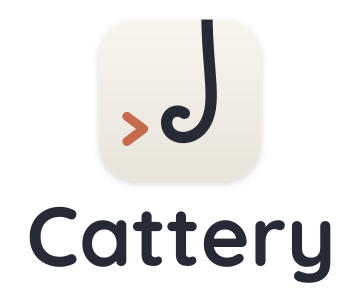
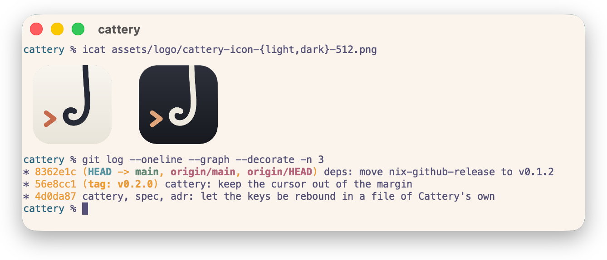

<p align="center">
  <picture>
    <source media="(prefers-color-scheme: dark)" srcset="assets/logo/cattery-logo-vertical-dark.svg">
    
  </picture>
</p>

<p align="center">
  A GUI terminal app built on the felis terminal daemon
</p>

<p align="center">
  <a href="#install">Install</a> ·
  <a href="#usage">Usage</a> ·
  <a href="https://github.com/lambdalisue/cattery/releases">Releases</a> ·
  <a href="docs/spec/">Specs</a>
</p>

<p align="center">
  <picture>
    <source media="(prefers-color-scheme: dark)" srcset="docs/images/screenshot-dark.png">
    
  </picture>
</p>

Cattery (a place that houses many cats) is a desktop app for
[felis](https://github.com/felis-terminal/felis) sessions. felis keeps each
session in a daemon and leaves windows to the window manager; Cattery is an
app that owns its windows: it opens a new one from its own menu, has an app
icon, and lets settings be changed in a Preferences window.

> [!NOTE]
> Cattery is early in development and not released yet.

## Install

On an Apple silicon Mac, with Homebrew:

```sh
brew install --cask lambdalisue/cattery/cattery
```

Each [release](https://github.com/lambdalisue/cattery/releases) also carries
the disk image for macOS and archives for Linux and Windows. Cattery.app is
signed by a self-signed certificate, not by an Apple Developer ID, so a
downloaded copy needs its quarantine removed (`xattr -dr
com.apple.quarantine /Applications/Cattery.app`) or opening allowed in
System Settings → Privacy & Security; the cask does this itself.

With Nix (prebuilt in the `cattery` Cachix cache):

```sh
nix profile add github:lambdalisue/cattery
```

On macOS the package holds `Applications/Cattery.app`, which Finder,
Launchpad and the Dock show as Cattery; the `cattery` on your `PATH` is the
same app.

## Usage

From the development shell:

```sh
cargo run
```

A window opens on your login shell. Closing it leaves the session running
in Cattery's daemon; the command palette (Command-P, or Control-Shift-P on
Linux and Windows) lists them, to open one in a window again or to end it.

The File menu opens more: **New Window** (Command-N) in your home
directory, **New Window Here** (Command-Shift-N) where the shell in front
last reported being. On Linux and Windows the chords are Control-Shift-N
and Control-Alt-Shift-N.

Command-comma (Control-comma on Linux and Windows) opens the Preferences
window, where the theme, the font, the cursor and the shell are chosen.
The settings are kept in `Cattery/` under your configuration directory
(`cattery/` on Linux): `config.toml` in felis's format, and `appearance.toml`
for the theme, the opacity and the blur.

Beyond that it does what a terminal app is expected to: select, copy and
paste, find in history, zoom, links opened with Command-click
(Control-click on Linux and Windows), images drawn with the kitty graphics
protocol, and stepping between prompts of a shell that marks them, which
Cattery sets zsh up to do. [docs/spec/window.md](docs/spec/window.md) has
the details.

## Development

Enter the development shell with `nix develop` (or copy `.envrc.sample` to
`.envrc` and `direnv allow`), then:

```sh
just fmt   # format every source
just ci    # everything CI runs: format check, lint, tests
```

The design lives in [docs/concept.md](docs/concept.md), the decisions behind it
in [docs/adr/](docs/adr/), and the behaviour it promises in
[docs/spec/](docs/spec/).

## License

MIT. See [LICENSE](LICENSE).
